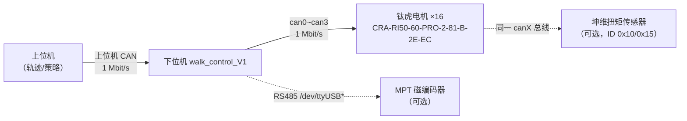

# 腿臂状态反馈与状态码说明（上位机视角）

> **文档定位**：本文档描述 **下位机（`walk_control_V1`）→ 上位机** 的状态反馈契约。
> 全文分两栏标注：
>
> - **【已实现】** = 当前代码里已经跑得通、上位机今天就能用的
> - **【待新增】** = 建议补充的定义，需要下位机固件配合改动，尚未实现
>
> **上位机只走 CAN，不引入 ROS2。** 仓库里 `ros2_ws/` 的三个节点仅作单机调试工具，
> 本文档的接口定义不依赖它们（附录 F 附了对照表，方便用 ROS2 做交叉验证，但最终上
> 位机不需要 ROS2）。
>
> **配套文档**：`README.md`「上位机关节位置流协议」节、`docs/step_protocol.pdf`、
> `docs/api.md`

---

## 目录

- [0. 名词与系统分层](#0-名词与系统分层)
- [1. 第一部分：腿臂要证明「我在正常工作」需要哪些状态](#1-第一部分腿臂要证明我在正常工作需要哪些状态)
  - [L0 上电自检与就绪](#l0-上电自检与就绪)
  - [L1 关节运动状态](#l1-关节运动状态)
  - [L2 关节故障状态](#l2-关节故障状态)
  - [L3 通讯与总线健康](#l3-通讯与总线健康)
  - [L4 运行模式与使能](#l4-运行模式与使能)
  - [L5 热与供电](#l5-热与供电)
  - [汇总：状态清单总表](#汇总状态清单总表)
- [2. 第二部分：上位机怎么查询](#2-第二部分上位机怎么查询)
  - [2.1 接口总矩阵](#21-接口总矩阵)
  - [2.2 【已实现】帧格式详表](#22-已实现帧格式详表)
  - [2.3 【待新增】帧格式详表](#23-待新增帧格式详表)
  - [2.4 超时与超时判据](#24-超时与超时判据)
  - [2.5 命名冲突警示](#25-命名冲突警示)
- [3. 正常 / 降级 / 故障 三态判定](#3-正常--降级--故障-三态判定)
- [4. 上位机实现建议](#4-上位机实现建议)
- [5. 已知缺口清单](#5-已知缺口清单)
- [附录 A：钛虎电机 `0x0A` 错误位全表](#附录-a钛虎电机-0x0a-错误位全表)
- [附录 B：电机读取命令码全表](#附录-b电机读取命令码全表)
- [附录 C：单位与换算](#附录-c单位与换算)
- [附录 D：软限位与关节参数](#附录-d软限位与关节参数)
- [附录 E：关节 ID 映射表](#附录-e关节-id-映射表)
- [附录 F：ROS2 调试接口对照（仅调试用）](#附录-fros2-调试接口对照仅调试用)

---

## 0. 名词与系统分层

### 0.1 「腿臂」在本仓库中的含义

| 项 | 数量 | 说明 |
|---|---|---|
| 腿臂（leg） | 4 | 编号 1~4 |
| 每腿关节 | 4 | J1~J4，构型 **YPPY** |
| 关节总数 | **16** | 全局 ID 1~16 |
| 电机总线 | 4 | 腿 *i* ↔ `can{i-1}`（can0~can3），每总线 4 个电机，电机 ID 1~4 |
| 上位机总线 | 1 | 独立物理 CAN 口（例如 can4），**不得与 can0~can3 共用** |

### 0.2 三段链路



**状态反馈的每一层都可能断，所以状态码必须能定位"断在哪一段"**：

| 断在哪 | 上位机看到的现象 |
|---|---|
| 上位机 ↔ 下位机 | `0x161` 心跳完全不来 |
| 下位机 ↔ 电机 | 心跳正常，但该关节 ID 的 `0x41` 位置帧不更新 |
| 电机本体故障 | 位置帧正常，但该关节 `0x0A` 错误位非 0 |
| 机械卡死/被顶住 | 位置帧正常，但**跟随误差**持续偏大 |

这四条判据是整份文档的主干。

---

## 1. 第一部分：腿臂要证明「我在正常工作」需要哪些状态

按"从开机到运行"的时间顺序分 6 层。每层给出：**要什么** / **为什么** / **现状**。

### L0 上电自检与就绪

> 回答一句话问题：**"我能不能开始接收运动指令？"**

| # | 状态项 | 判据 | 现状 |
|---|---|---|---|
| L0-1 | 下位机进程存活 | `0x161` 心跳按 200 ms 周期到达 | **【已实现】** |
| L0-2 | 16 个电机全部应答 | 逐 ID 读 `0x41` 成功 | **【已实现，但只打印到终端】** 上位机看不到 |
| L0-3 | `0x0A` 错误位全清 | 16 个电机 `error_bits == 0` | **【已实现读取能力，未上报】** 启动只 `clearError()`，从不读回验证 |
| L0-4 | 母线电压在窗内 | `0x14` ∈ [`0x8C` 低压阈值, `0x8A` 过压阈值] | **【待新增】** 从未采集 |
| L0-5 | 电机内部编码器正常 | `0x0A` bit16 (编码器通讯错) == 0 | **【待新增】** |
| L0-6 | 外部 MPT 磁编可读 | 串口应答 + error bit == 0 | **【待新增】** 编码器节点独立运行，不参与自检 |
| L0-7 | 软限位配置一致 | `0x1A`/`0x1B` 读回值 == 下位机 `kJointLimitDeg` | **【待新增】** |
| L0-8 | 自检结论 | PASS / DEGRADED / FAIL + 失败项位图 | **【待新增】** |

**为什么要自检结论而不是原始数据**

原始数据（电压多少、哪个错误位）上位机要自己拼判据，容易漏；一个"结论 + 失败项位图"让上位机能一行代码决策：

```
if (结论 == FAIL)       → 不允许下发运动指令
if (结论 == DEGRADED)   → 允许下发，但界面上标黄，且禁用大步长轨迹
if (结论 == PASS)       → 正常工作
```

**注意：现有 `clearError()` 的语义是"清除锁存故障"，不是"自检"。**
`initLeg()` 里对 4 个电机逐一 `clearError()` 之后就认为准备就绪了——如果某个电机
存在**持续性**故障（例如真的欠压），错误位会被立刻重新置位，而下位机不会去复查，
上位机也就完全不知道。这是当前最大的自检缺口。

**建议的自检项覆盖**（用户已确认）：16 电机 `0x41` 应答 / `0x0A` 清零 / `0x14` 电压窗 / MPT 磁编可读与 error bit。

---

### L1 关节运动状态

> 回答一句话问题：**"每个关节现在在哪、动得快不快、吃力不吃力、有没有跑偏？"**

| # | 状态项 | 单位 / 表示 | 现状 |
|---|---|---|---|
| L1-1 | 关节位置 | 关节端 rad，`int32 × 10000` | **【已实现】** ID 1~16，10 Hz |
| L1-2 | 关节速度 | 关节端 rad/s | **【待新增】** 电机侧可取（`0x06` / `0x41` 的 vel 字段），下位机未转发 |
| L1-3 | 电机电流 | mA | **【待新增】** 同上 |
| L1-4 | **跟随误差** | (目标 − 实际)，关节端 rad | **【待新增】** 下位机内部有 `target_rad[]` / `fb_rad[]`，但从不做差、不上报 |
| L1-5 | 到位标志 | `\|跟随误差\| < 0.02 rad (≈1.15°)` | **【待新增】** 仅在键盘 `move` 命令里做得到位确认，流模式下没有 |
| L1-6 | 运动中标志 | 未到位 | **【待新增】** |
| L1-7 | 反馈新鲜度 | 距上一帧的毫秒数 / 有效位 | **【待新增】** 见 L3-5 |

**为什么"跟随误差"最重要**

位置帧只能证明"电机读到自己在哪"，不能证明"电机听话"。三种典型异常，位置帧全都正常：

| 异常 | 现象 | 只有跟随误差能发现 |
|---|---|---|
| 电机未使能（抱闸未解） | 目标 90°，实际一直 0°，位置帧稳定报 0 | ✅ 误差恒等于目标 |
| 关节被机械顶住 / 卡死 | 目标持续增大，实际纹丝不动 | ✅ 误差单调发散 |
| 增益过低 / 负载过大 | 实际缓慢跟随，永远差一截 | ✅ 误差稳定在一个非零值 |

> 现状证据：`README.md` 第 1427 行的排错条目就是"发完一遍后关节不动 → 电机未使能"。
> 这个问题今天只能靠人看角度猜，加上跟随误差后上位机能直接判定。

**建议的到位阈值**：沿用源码常量 `kSettleThresholdRad = 0.02 rad`（关节端，≈1.15°）。

---

### L2 关节故障状态

> 回答一句话问题：**"哪个关节坏了、坏在哪、能不能自己恢复？"**

| # | 状态项 | 现状 |
|---|---|---|
| L2-1 | 电机 `0x0A` 错误位（32 位） | **【已实现读取能力】** `JointModule::readErrorState()` 可用；**未上报** |
| L2-2 | 错误分类（可恢复 / 需重启 / 需人工） | **【待新增】** 见下表 |
| L2-3 | 软限位报警 + 报警关节 + 侧别 + 触发角 | **【已实现】** `0x162` |
| L2-4 | 软限位报警锁存状态 | **【已实现】** `0x161` bit2 |
| L2-5 | 急停锁定状态 | **【待新增】** 内部 `g_estop_locked` 存在，但**不上报** |
| L2-6 | 故障聚合（全机最严重故障码） | **【待新增】** `0x162` 只报**第一个**越限关节 |

**错误分类建议（对应 `0x0A` 位，全表见附录 A）**

| 分类 | 涉及的位 | 上位机应对 |
|---|---|---|
| **可恢复**（清错后重试） | bit0, bit4, bit5, bit7 | 发 `0x0B` 清错，观察 1 s 内是否复现 |
| **需人工干预**（不能自动重试） | bit1 过压, bit2 欠压 | 停机、检查供电、等电压恢复 |
| **需散热** | bit17 电机过温, bit18 板过温 | 停机等待降温，禁止继续出力 |
| **硬件级**（大概率不可恢复） | bit6 过流, bit16 编码器通讯错, bit19 驱动芯片错 | 停机、报错、禁止自动恢复 |
| **未定义** | bit3, bit8~15, bit20~31 | 按"未知故障"处理，保守停机 |

**注意 `0x0A` 的锁存语义**：钛虎电机的错误位是**锁存**的——触发后即使原因消失，
位仍然保持 1，必须发 `0x0B` 清除。所以上位机看到故障，要区分"活动故障"和"历史故障"，
判据是：`清错 → 100 ms 后重读`，仍为 1 才是活动故障。

---

### L3 通讯与总线健康

> 回答一句话问题：**"链路是通的、还是通的但很脏？"**

| # | 状态项 | 现状 |
|---|---|---|
| L3-1 | 心跳是否到达 | **【已实现】** `0x161`，超时判据建议 1 s（5 个周期） |
| L3-2 | 心跳序号 / 计数器 | **【待新增】** 无序号 ⇒ **丢一帧和死机无法区分** |
| L3-3 | 各关节反馈是否在更新 | **【已实现，但间接】** 位置帧不更新就说明该关节断了；没有显式的新鲜度标志 |
| L3-4 | 上位机帧被丢弃计数 | **【待新增】** 内部有统计（键盘 `stat` 可看），不上报 |
| L3-5 | 每关节读超时次数 | **【待新增】** 内部有 `offline_streak[]` / `motor_online[]`，不上报 |
| L3-6 | 总线错误计数（berr / 帧错误 / BUS-OFF） | **【待新增】** 可从 `ip -s -d link show canX` 取，但下位机不上报 |
| L3-7 | 端到端延迟 | **【待新增】** |
| L3-8 | 通讯健康度（0~100 的综合分） | **【待新增】** |

**为什么心跳必须有序号**

今天上位机只能判断"1 s 内有没有收到心跳"。三种故障在它眼里完全一样：

1. 下位机进程崩了
2. 上位机 CAN 口接触不良，丢了几个帧
3. 总线 ERROR-PASSIVE / BUS-OFF

加一个 `data[1] = 序号 (0~255 循环)`，上位机算出"应到 N 帧、实到 M 帧"，就能：
- 序号连续、计数对得上 → 链路完好
- 序号跳变、但周期正常 → 中间丢帧（接触不良或总线负载/错误）
- 序号停住 → 下位机死机

**下位机现场的错误计数参考**（README 第 404 行）：CAN 口上没有任何节点时，
TX 错误计数器会涨到 128 进入 ERROR-PASSIVE，这是**正常现象**，不是故障。
所以判据要看 `berr-rx` / `berr-tx` 的**增速**，而不是看绝对值。

---

### L4 运行模式与使能

> 回答一句话问题：**"我现在听谁的？能不能动？"**

| # | 状态项 | 现状 |
|---|---|---|
| L4-1 | 流模式（上位机控权）开 / 关 | **【已实现】** `0x161` bit0 |
| L4-2 | 最近 1 s 内有样点 | **【已实现】** `0x161` bit1 |
| L4-3 | 软限位报警锁定 | **【已实现】** `0x161` bit2 |
| L4-4 | 急停锁定 | **【待新增】** 内部有，不上报 |
| L4-5 | 电机使能 / 抱闸状态 | **【待新增】** `leg.armed` 内部有，不上报 |
| L4-6 | 当前控制模式（位置 / 速度 / 电流） | **【待新增】** 电机侧 `0x03` 可读 |
| L4-7 | 上位机侧急停与使能命令 | **【待新增】** ⚠️ **上位机今天没有急停通道，也没有重新使能通道** |

**L4-7 是当前最严重的功能缺口**

现状：

- 使能（解抱闸）**只在**下位机启动时自动执行一次，或键盘敲 `arm`；
- 急停**只能**在下位机键盘上敲 `estop`。

也就是说：**上位机没有任何办法急停腿臂，也没有任何办法在一台电机掉使能后把它重新使能。**
这在真机上是很危险的。建议必须新增两个上位机命令（见 [2.3](#23-待新增帧格式详表) 的 `0x23` / `0x24`）。

---

### L5 热与供电

> 回答一句话问题：**"还能撑多久？"**

| # | 状态项 | 来源 | 现状 |
|---|---|---|---|
| L5-1 | 母线电压 | 电机 `0x14`（V） | **【已实现读取能力，未上报】** |
| L5-2 | 线圈 NTC 温度 | 电机 `0x31`（℃） | **【待新增】** 从未读过 |
| L5-3 | MOS 管温度 | 电机 `0x32`（℃） | **【待新增】** 从未读过 |
| L5-4 | 低压 / 过压阈值 | 电机 `0x8C` / `0x8A`（V） | **【已实现读取能力，未上报】** |
| L5-5 | 过温阈值 | 电机 `0x8F` 线圈 / `0x93` 驱动板（℃） | **【待新增】** |
| L5-6 | 当前电流 | 电机 `0x04` / `0x41`（mA） | **【已实现读取能力，未上报】** |

**采集频率建议**：电压 + 电流 20 Hz（跟关节状态一起）、温度 1 Hz（热惯性大，不需要快）。

---

### 汇总：状态清单总表

| 层 | 状态项 | 现状 | 建议承载 |
|---|---|---|---|
| L0-1 | 心跳存活 | 已实现 | `0x161` |
| L0-2 | 16 电机应答 | 已实现·未上报 | `0x163` data[2..3] |
| L0-3 | `0x0A` 清零 | 已实现·未上报 | `0x163` data[4..5] + `0x180+` data[4..7] |
| L0-4 | 电压在窗 | 待新增 | `0x163` data[6] + `0x164` data[4] |
| L0-5 | 电机编码器 | 待新增 | `0x0A` bit16 → `0x163` data[7] bit3 |
| L0-6 | MPT 磁编 | 待新增 | `0x163` data[7] bit4/5 |
| L0-7 | 软限位一致 | 待新增 | `0x163` data[7] bit6 |
| L0-8 | 自检结论 | 待新增 | `0x163` data[1] |
| L1-1 | 关节位置 | 已实现 | ID 1~16 `[0x41]` |
| L1-2 | 关节速度 | 待新增 | `0x170+` data[1..2] |
| L1-3 | 电流 | 待新增 | `0x170+` data[3..4] |
| L1-4 | 跟随误差 | 待新增 | `0x170+` data[6..7] |
| L1-5/6 | 到位 / 运动中 | 待新增 | `0x170+` data[5] bit2/3 |
| L1-7 | 新鲜度 | 待新增 | `0x170+` data[5] bit0 |
| L2-1 | `0x0A` 错误位 | 已实现·未上报 | `0x180+` data[4..7] |
| L2-3/4 | 软限位报警 | 已实现 | `0x162` + `0x161` bit2 |
| L2-5 | 急停锁定 | 待新增 | `0x164` data[1] bit3 |
| L2-6 | 故障聚合 | 待新增 | `0x164` data[6] |
| L3-1 | 心跳 | 已实现 | `0x161` |
| L3-2 | 心跳序号 | 待新增 | `0x167` data[1] |
| L3-4/5 | 丢帧 / 超时 | 待新增 | `0x167` data[2..6] |
| L3-8 | 通讯健康度 | 待新增 | `0x167` data[7] |
| L4-1~3 | 流 / 样点 / 限位锁 | 已实现 | `0x161` bit0~2 |
| L4-4/5 | 急停锁 / 使能 | 待新增 | `0x164` data[1] bit3/4 |
| L4-7 | 上位机急停 / 使能 | 待新增 | 命令 `0x23` / `0x24` / `0x25` |
| L5-1~3 | 电压 / 温度 | 部分已实现 | `0x180+` data[1..3] |

---

## 2. 第二部分：上位机怎么查询

### 2.1 接口总矩阵

**广播类（下位机主动发，上位机被动收）**

| CAN ID | DLC | 内容 | 周期 | 现状 |
|---|---|---|---|---|
| **1 ~ 16** | 5 | 关节实际位置 `[0x41][int32 LE rad×10000]` | 10 Hz | ✅ 已实现 |
| **`0x161`** | 1 | 心跳（3 个状态位） | 200 ms | ✅ 已实现 |
| **`0x162`** | 8 | 软限位报警（关节 ID + 侧别 + 角度） | 200 ms（锁定期重发） | ✅ 已实现 |
| `0x163` | 8 | **自检报告** | 上电广播 3 次 | ⬜ 待新增 |
| `0x164` | 8 | **系统聚合状态** | 100 ms | ⬜ 待新增 |
| `0x167` | 8 | **通讯质量统计** | 1 s | ⬜ 待新增 |
| `0x170` ~ `0x17F` | 8 | **关节扩展状态**（速度/电流/跟随误差/标志） | 20 Hz | ⬜ 待新增 |
| `0x180` ~ `0x18F` | 8 | **关节热与供电**（温度/电压/`0x0A` 全 32 位） | 1 Hz | ⬜ 待新增 |

**点名类（上位机发请求，下位机立即应答）**

| 上位机帧 | 下位机应答 | 内容 | 现状 |
|---|---|---|---|
| ID 1~16, `[0x41]` DLC=1 | 该 ID 的 `[0x41][int32]` DLC=5 | 单个关节位置 | ✅ 已实现 |
| 任意 ID, `[0x20]` DLC=1 | `0x163` | 自检报告 | ⬜ 待新增 |
| 任意 ID, `[0x21]` DLC=1 | `0x164` | 系统状态快照 | ⬜ 待新增 |
| 任意 ID, `[0x22]` DLC=1 | `0x167` | 通讯统计快照 | ⬜ 待新增 |

**控制类（上位机 → 下位机）**

| 命令 | DLC | 含义 | 现状 |
|---|---|---|---|
| `[0x1E][int32 LE rad×10000]` | 5 | 关节目标位置（10 Hz 流） | ✅ 已实现 |
| `[0x02]` | 1 | 退出流模式（电机保持，**不抱闸**） | ✅ 已实现 |
| `[0x03]` | 1 | 清除软限位报警锁 | ✅ 已实现 |
| `[0x23]` | 1 | **急停**（抱闸 + 锁定） | ⬜ 待新增 |
| `[0x24]` | 1 | **使能 / 解抱闸** | ⬜ 待新增 |
| `[0x25]` | 1 | **去使能 / 抱闸** | ⬜ 待新增 |
| `[0x26]` | 1 | **清除全部可恢复故障**（含 `0x0B` 透传） | ⬜ 待新增 |

---

### 2.2 【已实现】帧格式详表

#### ① 上位机 → 下位机：关节目标位置（`0x1E`）

| 项 | 值 |
|---|---|
| CAN ID | `(腿号 − 1) × 4 + 关节号`，范围 **1 ~ 16** |
| DLC | 5 |
| 发送周期 | **10 Hz**（每周期 16 帧，全部关节都要发） |
| 字节布局 | `data[0] = 0x1E`<br/>`data[1..4] = int32 小端，关节端 rad × 10000` |
| 分辨率 | 1 LSB = 0.0001 rad ≈ 0.0057° |
| 越限行为 | **钳位下发**（不拒绝）：目标被夹到软限位值，关节走到限位后停住，终端打印一次提示 |
| 静默超时 | 流停止 **> 1000 ms** → 自动退出流模式，电机**保持位置（不抱闸）** |

```
字节:  [0]     [1]      [2]      [3]      [4]
       0x1E    b0       b1       b2       b3
               └──────── int32 LE = rad × 10000 ────────┘
```

C 打包示例：

```c
// joint_rad: 关节端弧度（不是电机输出端，J2/J3 差 2 倍！）
int32_t scaled = (int32_t)lround(joint_rad * 10000.0);
uint8_t d[5] = { 0x1E,
                 (uint8_t)(scaled      ), (uint8_t)(scaled >>  8),
                 (uint8_t)(scaled >> 16), (uint8_t)(scaled >> 24) };
```

#### ② 下位机 → 上位机：关节实际位置（ID 1~16）

| 项 | 值 |
|---|---|
| CAN ID | 1 ~ 16 |
| DLC | 5 |
| 发送周期 | **10 Hz**（数据源：下位机每 100 ms 对该腿 4 个电机做一轮 `0x41` 三合一读） |
| 字节布局 | `data[0] = 0x41`<br/>`data[1..4] = int32 小端，实际关节端 rad × 10000` |
| 数据性质 | **可能是陈旧值**——见 [L3-5](#l3-通讯与总线健康) |

> ⚠️ **`data[0] = 0x41` 不是电机协议的功能码回显，它只是下位机自定义的"这是位置帧"标记。**
> 电机侧 `0x41` 是"读电流+速度+位置"，两者语义不同，只是借用了同一个字节值。

#### ③ 下位机 → 上位机：心跳（`0x161`）

| 项 | 值 |
|---|---|
| CAN ID | `0x161` |
| DLC | 1 |
| 周期 | **200 ms** |
| 字节布局 | `data[0]` 位域，见下表 |

| 位 | 掩码 | 含义 |
|---|---|---|
| bit0 | `0x01` | **流模式进行中**（已收到上位机有效 `[0x1E]` 帧且未超时） |
| bit1 | `0x02` | **样点在线**：最近 1 s 内收到过上位机样点 |
| bit2 | `0x04` | **软限位报警锁定中** |
| bit3~7 | — | 空闲（**建议扩充，见 2.3**） |

**上位机判据**：连续 **1 s**（5 个周期）收不到 `0x161` ⇒ 判定链路中断。
参考实现见 `tools/up_walk_control_V1.py` 的 `HB_LOST_S = 1.0`。

#### ④ 下位机 → 上位机：软限位报警（`0x162`）

| 项 | 值 |
|---|---|
| CAN ID | `0x162` |
| DLC | 8 |
| 周期 | **200 ms**，仅在锁定期间重发；解锁后停止 |

| 字节 | 内容 |
|---|---|
| `data[0]` | `0x62`（报警功能码） |
| `data[1]` | 报警关节的全局 ID（1~16） |
| `data[2]` | 侧别：`0x01` = 上限，`0x02` = 下限 |
| `data[3]` | `0x00` 保留 |
| `data[4..7]` | `int32 LE`，触发时的实际关节端角度 rad × 10000（**每次重发都刷新**） |

> ⚠️ **只报第一个越限关节。** 若多个关节同时越限，上位机只能看到最先触发的那个
> （`triggerLimitAlarm()` 里 `if (g_limit_locked) return;` 直接丢弃后续）。见 [5. 已知缺口](#5-已知缺口清单)。

**清除方式**：上位机发 `[0x03]` DLC=1（任意 ID 1~16），或下位机键盘敲 `clear`。
清除后需各关节**退离限位 2°**（`kLimitRearmDeg`）才允许再次触发，防止空转复发。

---

### 2.3 【待新增】帧格式详表

> 以下为建议设计，**共 5 组新帧 + 4 条新命令**，全部避开现有 ID（1~16、`0x161`、`0x162`）。
> 带宽开销合计约 **45 kbit/s**，占 1 Mbit/s 总线的 4.5%，可忽略。

#### 新增帧 ID 规划

```
1 ~ 16          关节位置（已占用）
0x161           心跳（已占用）
0x162           软限位报警（已占用）
───────────────────────────────────────
0x163           自检报告
0x164           系统聚合状态
0x165 ~ 0x166   保留
0x167           通讯质量统计
0x170 ~ 0x17F   关节扩展状态  （16 个 ID，0x170 + 关节ID − 1）
0x180 ~ 0x18F   关节热与供电  （16 个 ID，0x180 + 关节ID − 1）
```

#### ① `0x163` 自检报告帧（DLC=8）

**触发**：下位机启动自检完成后广播 **3 次**（间隔 200 ms）；上位机发 `[0x20]` 时再应答一次。

| 字节 | 内容 |
|---|---|
| `data[0]` | `0x63` 功能码 |
| `data[1]` | **自检结论**：`0x00` 未完成 / `0x01` **PASS** / `0x02` **DEGRADED** / `0x03` **FAIL** |
| `data[2..3]` | `uint16 LE`，**电机在线位图**：bit *n* = 关节 ID (*n*+1) 的电机应答了 `0x41` |
| `data[4..5]` | `uint16 LE`，**故障位图**：bit *n* = 关节 ID (*n*+1) 的 `0x0A` 错误位非 0 或读失败 |
| `data[6]` | **母线电压**（uint8，V）；`0xFF` = 未知，请查 `0x164` |
| `data[7]` | **自检项失败位图**，见下表 |

`data[7]` 位定义：

| 位 | 掩码 | 失败项 |
|---|---|---|
| bit0 | `0x01` | 有电机不在线（细节看 `data[2..3]`） |
| bit1 | `0x02` | 有电机 `0x0A` 错误位非 0（细节看 `data[4..5]` + `0x180+`） |
| bit2 | `0x04` | 母线电压超出 [`0x8C`, `0x8A`] 窗 |
| bit3 | `0x08` | 有电机报编码器通讯错（`0x0A` bit16） |
| bit4 | `0x10` | MPT 磁编不可读 |
| bit5 | `0x20` | MPT 磁编 error bit 置位 |
| bit6 | `0x40` | 软限位配置与下位机常量不一致 |
| bit7 | `0x80` | 保留 |

**结论判定规则**（下位机侧）：

```
FAIL      : 在线位图 != 0xFFFF，或任一 data[7] bit ∈ {bit0, bit3, bit4}
DEGRADED  : 能跑，但有告警（电压偏高/偏低但仍可动、温度偏高、MPT 降级）
PASS      : 在线位图 == 0xFFFF 且 data[4..5] == 0 且 data[7] == 0
```

#### ② `0x164` 系统聚合状态帧（DLC=8，100 ms）

**作用**：一帧看全机，比心跳信息量大但周期更短。

| 字节 | 内容 |
|---|---|
| `data[0]` | `0x64` 功能码 |
| `data[1]` | **状态字**（见下表，**bit0~2 与 `0x161` 完全一致**，便于统一解析） |
| `data[2]` | 电机在位位图低 8 位（关节 ID 1~8） |
| `data[3]` | 电机在位位图高 8 位（关节 ID 9~16） |
| `data[4]` | 母线电压（uint8，V） |
| `data[5]` | 全部关节中的**最高温度**（int8，℃，`-128` = 未知） |
| `data[6]` | **最严重故障码**，见下表 |
| `data[7]` | 通讯健康度 0~100（100 = 完美，与 `0x167` data[7] 同源） |

`data[1]` 状态字：

| 位 | 掩码 | 含义 | 与 `0x161` 关系 |
|---|---|---|---|
| bit0 | `0x01` | 流模式进行中 | = `0x161` bit0 |
| bit1 | `0x02` | 最近 1 s 有样点 | = `0x161` bit1 |
| bit2 | `0x04` | 软限位报警锁定 | = `0x161` bit2 |
| bit3 | `0x08` | **急停锁定** | 新增 |
| bit4 | `0x10` | **全部电机已使能（抱闸解除）** | 新增 |
| bit5 | `0x20` | **全部电机在线** | 新增 |
| bit6 | `0x40` | **供电正常**（电压在窗内） | 新增 |
| bit7 | `0x80` | **存在未清除故障** | 新增 |

`data[6]` 最严重故障码（枚举，值越小越严重）：

| 码 | 含义 | 建议上位机动作 |
|---|---|---|
| `0x00` | 无故障 | — |
| `0x01` | 电机过流（`0x0A` bit6） | 立即停机 |
| `0x02` | 驱动芯片错误（bit19） | 立即停机 |
| `0x03` | 编码器通讯错（bit16） | 立即停机 |
| `0x04` | 电机过温（bit17） | 停机散热 |
| `0x05` | 驱动板过温（bit18） | 停机散热 |
| `0x06` | 欠压（bit2） | 停机查供电 |
| `0x07` | 过压（bit1） | 停机查供电 |
| `0x08` | 软限位报警锁定 | 发 `0x03` 清除或反向退出 |
| `0x09` | 急停锁定 | 发 `0x24` 重新使能 |
| `0x0A` | 跟随误差超限 | 检查机械卡阻 |
| `0x0B` | 电机离线 | 查 CAN 接线 / 电机供电 |
| `0x0C` | 自检未通过 | 见 `0x163` |
| `0x0D` | 其他 / 未定义位 | 读 `0x180+` 看原始位 |

#### ③ `0x167` 通讯质量统计帧（DLC=8，1 s）

| 字节 | 内容 |
|---|---|
| `data[0]` | `0x67` 功能码 |
| `data[1]` | **心跳序号**（uint8，0~255 循环递增）← 解决"丢帧 vs 死机"不可区分 |
| `data[2..3]` | `uint16 LE`，**本秒收到上位机有效帧数**（满负荷应为 160 = 16 关节 × 10 Hz） |
| `data[4..5]` | `uint16 LE`，**本秒丢弃帧数**（越限钳位 / 未使能 / 锁定中 / 校验失败） |
| `data[6]` | **最大连续读失败次数**（16 个关节中的最大值，饱和 255） |
| `data[7]` | 通讯健康度 0~100 |

**健康度算法建议**：

```
recv_ratio  = min(1.0, 本秒收到帧数 / 160.0)
drop_ratio  = 1.0 - min(1.0, 本秒丢弃帧数 / max(1, 本秒收到帧数))
online_cnt  = popcount(在位位图)                      // 0~16
health = round(100 * recv_ratio * drop_ratio * (online_cnt / 16.0))
```

#### ④ `0x170` ~ `0x17F` 关节扩展状态帧（DLC=8，20 Hz）

CAN ID = `0x170 + (关节ID − 1)`，即关节 1 → `0x170`，关节 16 → `0x17F`。

| 字节 | 内容 |
|---|---|
| `data[0]` | `0x71` 功能码 |
| `data[1..2]` | `int16 LE`，**关节端速度 × 1000**（rad/s，1 LSB = 0.001 rad/s，量程 ±32.7 rad/s） |
| `data[3..4]` | `int16 LE`，**电机电流 ÷ 10**（mA，1 LSB = 10 mA，量程 ±327 A） |
| `data[5]` | **关节状态位图**，见下表 |
| `data[6..7]` | `int16 LE`，**跟随误差 × 1000**（关节端 rad，1 LSB = 0.001 rad ≈ 0.057°，量程 ±32.7 rad） |

`data[5]` 状态位图：

| 位 | 掩码 | 含义 |
|---|---|---|
| bit0 | `0x01` | **在线**：最近一次 `0x41` 读到过有效值（本帧数据可信） |
| bit1 | `0x02` | **已使能**（抱闸解除） |
| bit2 | `0x04` | **到位**（`\|跟随误差\| < 0.02 rad`） |
| bit3 | `0x08` | **运动中**（未到位） |
| bit4 | `0x10` | **跟随误差超限**（`\|误差\| > 阈值`，默认 5° = 0.0873 rad） |
| bit5 | `0x20` | **该关节处于软限位**（实际角贴近限位） |
| bit6 | `0x40` | **该关节有未清除故障**（`0x0A` != 0） |
| bit7 | `0x80` | 保留 |

> ⚠️ **bit0 = 0 时，本帧的速度/电流/跟随误差都是上一轮的陈旧值，必须丢弃。**
> 这条是本设计里最重要的约定——它把当前"重发陈旧值但不说"的隐患（见 [5. 已知缺口](#5-已知缺口清单)）彻底堵掉。

#### ⑤ `0x180` ~ `0x18F` 关节热与供电帧（DLC=8，1 Hz）

CAN ID = `0x180 + (关节ID − 1)`。

| 字节 | 内容 |
|---|---|
| `data[0]` | `0x81` 功能码 |
| `data[1]` | 线圈 NTC 温度（int8，℃，`电机 0x31`；`-128` = 不可用） |
| `data[2]` | MOS 管温度（int8，℃，`电机 0x32`；`-128` = 不可用） |
| `data[3]` | 母线电压（uint8，V，`电机 0x14`） |
| `data[4..7]` | **电机 `0x0A` 错误位完整 uint32 LE** |

`data[4..7]` 是唯一能拿到 32 位错误位全貌的通道，位定义见 [附录 A](#附录-a钛虎电机-0x0a-错误位全表)。

#### ⑥ 新增上位机命令

| 命令 | DLC | 字节布局 | 语义 |
|---|---|---|---|
| **`0x23` 急停** | 1 | `[0x23]` | 全部电机 `0x02` 抱闸 + 退出流模式 + 进入急停锁定（拒绝一切目标） |
| **`0x24` 使能** | 1 | `[0x24]` | 逐电机 `clearError()` → `setTargetCurrent(0)` 解抱闸 → 切回位置模式保持当前姿态；同时解除急停锁定 |
| **`0x25` 去使能** | 1 | `[0x25]` | 全部电机 `0x02` 抱闸并锁定（等价 `0x23`，语义区分：主动停机 vs 紧急） |
| **`0x26` 清故障** | 1 | `[0x26]` | 逐电机 `0x0B` 清错 + 清除软限位报警锁；**不**改变锁定状态、**不**改变目标 |
| **`0x20` 请求自检** | 1 | `[0x20]` | 下位机立即回一帧 `0x163`（重新跑一遍自检） |
| **`0x21` 请求系统快照** | 1 | `[0x21]` | 立即回一帧 `0x164` |
| **`0x22` 请求通讯快照** | 1 | `[0x22]` | 立即回一帧 `0x167` |
| **`0x27` 请求单关节诊断** | 2 | `[0x27][关节ID]` | 立即回该关节的 `0x170+` 和 `0x180+` 各一帧 |

**命令优先级**（下位机内部）：

```
0x23 急停  >  0x24/0x25 使能  >  0x26 清故障  >  0x1E 位置流  >  0x20/0x21/0x22/0x27 查询
```

#### ⑦ 心跳位扩充建议（`0x161`）

若不想新增 `0x164`，也可以只把 `0x161` 的 bit3~7 用起来：

| 位 | 掩码 | 建议含义 |
|---|---|---|
| bit3 | `0x08` | 自检通过（PASS） |
| bit4 | `0x10` | 全部电机已使能 |
| bit5 | `0x20` | 母线电压正常 |
| bit6 | `0x40` | 存在未清除故障 |
| bit7 | `0x80` | 奇偶校验位（bit0~6 偶校验） |

> 但**不推荐只扩心跳**：心跳只有 1 字节、无序号、无实体故障细节，扩到 8 位也只是
> "多几个布尔"。建议 `0x161` 保持精简（兼容现有 `up_walk_control_V1.py`），
> 详细信息走 `0x164` 和 `0x167`。

---

### 2.4 超时与超时判据

| 链路环节 | 周期 | 超时判据 | 超时后的动作 |
|---|---|---|---|
| 心跳 `0x161` | 200 ms | **> 1000 ms** 未收到（5 个周期） | 判定上位机↔下位机链路断，禁止下发目标 |
| 关节位置 ID 1~16 | 100 ms | **> 500 ms** 该 ID 未更新（5 个周期） | 该关节数据标记为陈旧，不作为控制反馈 |
| 关节扩展 `0x170+` | 50 ms | **> 250 ms** 未更新 | 该关节速度/电流/跟随误差标记无效 |
| 关节热供 `0x180+` | 1000 ms | **> 3000 ms** 未更新 | 温度/电压/错误位标记无效 |
| 自检报告 `0x163` | 上电 3 次 | **> 3000 ms** 未收到任一帧 | 主动发 `[0x20]` 点名；仍无 → 判定下位机未就绪 |
| 系统状态 `0x164` | 100 ms | **> 500 ms** 未更新 | 降级为只看心跳 |
| 通讯统计 `0x167` | 1000 ms | **心跳序号连续 3 次不递增** | 下位机内部任务可能卡死 |
| 上位机流 `0x1E` | 100 ms（下位机侧） | **> 1000 ms** 无新样点 | 下位机自动退出流模式，电机**保持位置不抱闸** |

> **注意"保持不抱闸"的语义**：断流后腿不会塌，但也不会锁死。如果此时有人推它，
> 电机会被推着走。若需要断流即抱闸，必须上位机主动发 `[0x23]` 或 `[0x25]`。

---

### 2.5 命名冲突警示

同一套代码里，**电机总线**和**上位机总线**用了相同的命令字节值，含义完全不同。
写上位机时最容易在这里出错：

| 字节 | 在**电机总线**（can0~can3）上的含义 | 在**上位机总线**上的含义 |
|---|---|---|
| `0x02` | 停止电机 + **抱死刹车** | **退出流模式**（电机保持，不抱闸） |
| `0x03` | 获取运行模式 | **清除软限位报警锁** |
| `0x41` | 获取电流+速度+位置（8 字节应答） | 状态请求 / 位置回传标记（5 字节） |
| `0x1E` | 设置目标位置（cnt） | 关节目标位置（关节端 rad × 10000） |
| `0x0A` | 获取错误状态 | 未使用 |
| `0x14` | 获取母线电压 | 未使用 |

**结论：`0x02` 在两条总线上"一个抱闸一个不抱闸"，是最危险的一处差异。**
上位机发 `[0x02]` 只会让下位机退出流模式（电机保持），**不会抱闸**。

---

## 3. 正常 / 降级 / 故障 三态判定

上位机每次状态刷新后按顺序判，命中即停：

### 3.1 判定流程

```
① 心跳有没有？
   ├─ 1 s 无 0x161                → 【故障·LINK_LOST】
   │                                 动作：禁止下发目标、界面全红、告警
   └─ 有 → 继续
        ↓
② 自检结论？
   ├─ 0x163 未收到（3 s 且点名无应答） → 【故障·NO_SELFTEST】
   ├─ FAIL                          → 【故障·SELFTEST_FAIL】
   └─ PASS / DEGRADED → 继续
        ↓
③ 最严重故障码（0x164 data[6]）
   ├─ 0x01~0x07（硬件/供电/过温）    → 【故障·HARDWARE】
   │                                 动作：立即发 [0x23] 急停
   ├─ 0x08（软限位锁）              → 【降级·LIMIT_LOCKED】
   │                                 动作：停止下发，等操作员决定 [0x03] 或反向退出
   ├─ 0x09（急停锁）                → 【故障·ESTOP_LOCKED】
   │                                 动作：等人工确认后发 [0x24]
   ├─ 0x0A（跟随误差超限）           → 【降级·FOLLOWING_ERROR】
   ├─ 0x0B（电机离线）              → 【降级·JOINT_OFFLINE】
   └─ 0x00 → 继续
        ↓
④ 通讯健康度（0x167 data[7]）
   ├─ < 60                          → 【故障·COMM_DEGRADED】
   ├─ 60 ~ 85                       → 【降级·COMM_WARN】
   └─ > 85 → 继续
        ↓
⑤ 温度（0x164 data[5] / 0x180+ data[1..2]）
   ├─ > 过温阈值 - 10 ℃             → 【降级·OVERHEAT_WARN】
   ├─ > 过温阈值                    → 【故障·OVERHEAT】
   └─ 正常 → 继续
        ↓
⑥ 电压（0x164 data[4]）
   ├─ < 低压阈值 或 > 过压阈值       → 【故障·POWER】
   └─ 正常 → 【正常·OK】
```

### 3.2 三态对照表

| 状态 | 允许下发运动目标 | 允许大动作 | 上位机表现 | 典型原因 |
|---|---|---|---|---|
| **正常 OK** | ✅ | ✅ | 绿灯 | — |
| **降级 DEGRADED** | ✅（受限） | ❌ | 黄灯 + 文字提示 | 软限位锁、跟随误差偏大、单关节离线、通讯健康度 60~85、温度接近阈值 |
| **故障 FAULT** | ❌ | ❌ | 红灯 + 告警音 | 心跳丢失、自检 FAIL、过流过温过压欠压、编码器通讯错、急停锁、通讯健康度 < 60 |

### 3.3 单关节三态

| 状态 | 判据（来自 `0x170+` data[5] + `0x180+` data[4..7]） |
|---|---|
| 正常 | bit0 在线 ∧ bit6 无故障 ∧ `0x0A` == 0 ∧ bit4 误差未超限 |
| 降级 | bit0 在线，但 bit4 误差超限 或 bit5 在软限位 或 温度接近阈值 |
| 故障 | bit0 == 0（离线）或 bit6 有故障 或 `0x0A` != 0 |

---

## 4. 上位机实现建议

### 4.1 最小可用实现（今天就能做，只用【已实现】接口）

```c
// 每 10 ms 跑一次
void status_tick(void) {
    int64_t now = now_ms();

    // ① 心跳
    if (now - last_hb_ms > 1000) {
        state = FAULT_LINK_LOST;      // 全部目标停发
        return;
    }

    // ② 位置帧新鲜度（每关节）
    for (int id = 1; id <= 16; ++id) {
        joint[id].stale = (now - joint[id].last_pos_ms > 500);
    }

    // ③ 软限位锁
    if (hb_bits & 0x04) state = DEGRADED_LIMIT_LOCKED;

    // ④ 没有 0x163/0x164/0x167，只能到此为止
    //    ⇒ 剩下的判据（自检/故障/通讯质量）全部是盲区
}
```

**这套实现的能力边界**（必须写进上位机界面的"功能限制"说明）：

| 能发现 | 不能发现 |
|---|---|
| 上位机↔下位机链路断（心跳） | 电机侧任何故障（`0x0A`） |
| 某关节反馈停更（位置帧） | 电压/温度异常 |
| 软限位报警锁定 | 关节被顶住/卡死（位置帧照常） |
| — | 电机未使能（位置帧稳定报 0） |
| — | 下位机单帧丢失（无序号） |

### 4.2 完整实现（需下位机配合实现【待新增】帧）

```
上电
 ├─ 发 [0x20] 请求自检
 ├─ 等 0x163（最多 3 s，轮询 3 次）
 ├─ 结论 FAIL      → 界面锁死，提示失败项
 ├─ 结论 DEGRADED  → 允许小动作，界面标黄
 └─ 结论 PASS      → 进入运行态
      ↓
运行态（周期 10 ms）
 ├─ 收 0x161 / 0x164 / 0x167 → 更新链路与全机状态
 ├─ 收 0x170+ / 0x180+       → 更新 16 关节速度/电流/温度/误差
 ├─ 收 0x162               → 记录软限位报警
 ├─ 按 §3.1 判定三态，写入 state
 ├─ state == FAULT  → 立即发 [0x23] 急停，停发 [0x1E]
 ├─ state == DEGRADED → 限制目标变化率，只允许 ≤5°/s
 └─ state == OK    → 正常发 [0x1E] 10 Hz 流
```

### 4.3 建议的接收线程设计

```
一个 recv 线程（阻塞 recv，超时 5 ms）
  ├─ if (id >= 1   && id <= 16)   → 位置缓存
  ├─ if (id == 0x161)             → 心跳 + 序号 + 时间戳
  ├─ if (id == 0x162)             → 软限位报警明细
  ├─ if (id == 0x163)             → 自检结论
  ├─ if (id == 0x164)             → 全机状态
  ├─ if (id == 0x167)             → 通讯统计
  ├─ if (id >= 0x170 && id <= 0x17F) → 关节扩展（index = id - 0x170 + 1）
  ├─ if (id >= 0x180 && id <= 0x18F) → 关节热供（index = id - 0x180 + 1）
  └─ else                         → 忽略（可能是扭矩传感器 0x15 等其它节点）
```

发送线程独立（10 Hz 定时 + 事件驱动），收发**不要同一个线程**。

---

## 5. 已知缺口清单

按严重程度排序，均为本次代码走查确认：

| # | 缺口 | 影响 | 建议 |
|---|---|---|---|
| 1 | **上位机无急停通道** | 上位机没法让腿臂立即停下来，只能停发目标（= 电机保持不抱闸） | 新增 `[0x23]` |
| 2 | **上位机无重新使能通道** | 一台电机掉使能后，只能人去下位机键盘敲 `arm` | 新增 `[0x24]` |
| 3 | **`0x161` 心跳无序号** | 丢一帧 vs 下位机死机，无法区分 | 新增 `0x167` data[1] |
| 4 | **无开机自检结论** | 启动只 `clearError()` 就认为就绪；持续故障被静默 | 新增 `0x163` |
| 5 | **`0x0A` 错误位不上报** | 过压/欠压/过流/过温/编码器错，上位机全盲 | 新增 `0x180+` data[4..7] |
| 6 | **无跟随误差** | 卡死/被顶住/未使能，位置帧看起来都正常 | 新增 `0x170+` data[6..7] |
| 7 | **位置帧无新鲜度标志** | 下位机读电机失败时，`fb_rad[]` 保持旧值，仍按 10 Hz 发出去 | 新增 `0x170+` data[5] bit0 |
| 8 | **`0x162` 只报第一个越限关节** | 多关节同时越限时，其余被丢弃（`if (g_limit_locked) return;`） | `0x164` data[6] 给聚合码，或扩展 `0x162` 支持多帧 |
| 9 | **急停锁定 `g_estop_locked` 不上报** | 上位机不知道腿臂已被急停锁住，会一直发目标（被静默丢弃） | `0x164` data[1] bit3 |
| 10 | **`leg.armed`（使能/抱闸）不上报** | 上位机不知道抱闸解没解 | `0x164` data[1] bit4 |
| 11 | **无温度采集** | `0x31`/`0x32` 从未读过，无法做热保护 | 新增 `0x180+` |
| 12 | **无电压采集** | `0x14` 从未读过，无法做欠压保护 | 新增 `0x180+` data[3] |
| 13 | **无总线错误计数** | CAN 接触不良呈现为"偶尔卡一下"，无法定量 | `0x167` + 上位机侧查 `ip -s -d link show` |
| 14 | **MPT 磁编无健康话题/帧** | 编码器节点只有每秒一条 WARN 日志，无机器可读的健康状态 | 并入 `0x163` data[7] bit4/5 |
| 15 | **ROS2 `taihu_motor_node` 无条件发布 `joint_states`** | 读失败时重发陈旧值，无 validity 标志（若用 ROS2 调试会被误导） | 同一缺口 #7，CAN 方案已覆盖 |
| 16 | **丢弃计数不上报** | 越限钳位 / 未使能 / 锁定中的丢弃只打在终端 | `0x167` data[4..5] |

---

## 附录 A：钛虎电机 `0x0A` 错误位全表

来源：`电机协议_双编_Can版本_20250623.xlsx`（sheet1，功能码 `0x0A` "获取错误状态"）。

- 读命令：`[0x0A]` DLC=1，应答 5 字节 = `[0x0A][uint32 LE error_bits]`
- 语义：**对应位为 0 表示无错误，为 1 表示出现该错误**

| 位 | 掩码 | 含义 | 分类 | 能否 `0x0B` 清除 |
|---|---|---|---|---|
| bit0 | `0x00000001` | 电机内部软件错误（如电机运行时写入 FLASH） | 可恢复 | ✅ 通常可清 |
| bit1 | `0x00000002` | **过压** | 需人工（供电） | 需电压回落后才清得掉 |
| bit2 | `0x00000004` | **欠压** | 需人工（供电） | 需电压回落后才清得掉 |
| bit3 | `0x00000008` | 未定义 | 未知 | 按未知故障处理 |
| bit4 | `0x00000010` | 启动错误 | 可恢复 | ✅ |
| bit5 | `0x00000020` | 速度反馈错误 | 可恢复 | ✅ |
| bit6 | `0x00000040` | **过流** | 硬件级 | 需排查机械/增益 |
| bit7 | `0x00000080` | 软件错误（如电机运行时写入 FLASH） | 可恢复 | ✅ |
| bit8~15 | `0x0000FF00` | 未定义 | 未知 | — |
| bit16 | `0x00010000` | **编码器通讯错误** | 硬件级 | 需查编码器线束 |
| bit17 | `0x00020000` | **电机温度过高** | 需散热 | 温度降下来才清得掉 |
| bit18 | `0x00040000` | **电路板温度过高** | 需散热 | 同上 |
| bit19 | `0x00080000` | **驱动芯片错误** | 硬件级 | 大概率不可恢复 |
| bit20~31 | `0xFFF00000` | 未定义 | 未知 | — |

> ⚠️ **README 里只写了 bit2 = 欠压**，那是节选。上表才是完整定义。
> **`0x0A` 的错误位是锁存的**：原因消失后位仍然为 1，必须 `0x0B` 清除。
> 判断"活动故障"的方法：`0x0B 清错 → 等 100 ms → 重读`，仍为 1 才是活动的。

**相关阈值命令**（用于自检判据）：

| 功能码 | 含义 | 单位 |
|---|---|---|
| `0x8A` | 获取过压阈值 | V |
| `0x8B` | 获取正常电压 | V |
| `0x8C` | 获取低压阈值 | V |
| `0x8F` | 获取线圈过温阈值 | ℃ |
| `0x93` | 获取驱动板过温阈值 | ℃ |

---

## 附录 B：电机读取命令码全表

来源同上（sheet1「返回」段）。所有读命令：**发送 `[cmd]` DLC=1，应答 5 字节 `[cmd][int32 LE value]`**，
唯一例外是 `0x41`（8 字节）。

| 功能码 | 内容 | 单位 | 备注 |
|---|---|---|---|
| `0x02` | 停止电机 | — | 立刻停止并抱死刹车（写命令） |
| `0x03` | 获取运行模式 | — | int32 |
| `0x04` | 获取当前电流 | mA | |
| `0x05` | 获取目标电流 | mA | 仅电流模式有效 |
| `0x06` | 获取当前速度 | 0.01 Hz | `(值/100/减速比)×360` = 度/秒 |
| `0x07` | 获取目标转速 | 0.01 Hz | 仅速度模式有效 |
| `0x08` | 获取当前位置 | cnt | **输出端**，双编 `262144 cnt = 360°` |
| `0x09` | 获取目标位置 | cnt | 仅位置模式有效 |
| **`0x0A`** | **获取错误状态** | — | uint32 位域，见附录 A |
| `0x0B` | 清除电机错误 | — | 写命令 |
| `0x0D` | 恢复用户参数 | — | 需电机停止 |
| `0x0E` | 保存用户参数 | — | 需电机停止 |
| `0x0F` | 恢复出厂设置 | — | 需再保存 |
| `0x10`/`0x11` | 速度环 KP / KI | — | |
| `0x12`/`0x13` | 位置环 KP / KD | — | |
| **`0x14`** | **获取母线电压** | **V** | 供电实时电压 |
| `0x16`/`0x17` | 最大 / 最小加速度 | 0.01 Hz/ms | |
| `0x18`/`0x19` | 最大 / 最小速度 | 0.01 Hz | |
| `0x1A`/`0x1B` | 最大 / 最小软件限位 | cnt | |
| **`0x31`** | **获取线圈 NTC 温度** | **℃** | |
| **`0x32`** | **获取 MOS 管温度** | **℃** | |
| `0x33` | 速度环 KD | — | |
| `0x34` | 位置环 KI | — | |
| `0x35`/`0x36`/`0x37` | 最大 / 最小 / 绝对值最大电流 | mA | |
| `0x3B`/`0x3C` | 轮廓加速度 / 加加速度 | cnt/s², cnt/s³ | |
| **`0x41`** | **获取电流+速度+位置** | 组合 | **8 字节**：`int16 电流mA + int16 速度0.01Hz + int32 位置cnt` |
| `0x54` | 获取当前位置偏移 | cnt | `当前 = 编码器 − 偏移` |
| `0x64` | 电机型号 | 十六进制 | 自检可上报 |
| `0x65` | 软件版本号 | 十六进制 | 自检可上报 |
| `0x66` | 硬件版本号 | 十六进制 | 自检可上报 |
| `0x70` | 双编位置限制选择 | — | 0 不限制 / 1 限制 ±180° |
| `0x71` | 8 字节模式选择 | — | 0 力位混合 / 1 轮廓位置 |
| `0x78` | 编码器电池电压 | V | 应 > 2.6 V |
| `0x79` | 当前位置（内圈） | — | 双编**输入端** |
| `0x8A`/`0x8B`/`0x8C` | 过压 / 正常 / 低压阈值 | V | |
| `0x8F` | 线圈过温阈值 | ℃ | |
| `0x93` | 驱动板过温阈值 | ℃ | |
| `0x94`/`0x95` | 内部单圈值 / 多圈数 | cnt | 双编输入端 |
| `0x96`/`0x97` | 输出端单圈值 / 多圈数 | cnt | 双编输出端 |

---

## 附录 C：单位与换算

### C.1 下位机 → 上位机（关节端，上位机直接用）

| 量 | 单位 | 分辨率 |
|---|---|---|
| 关节位置 | rad（关节端） | `int32 × 10000` ⇒ 0.0001 rad ≈ **0.0057°** |
| 关节速度 | rad/s（关节端） | 建议 `int16 × 1000` ⇒ 0.001 rad/s |
| 跟随误差 | rad（关节端） | 建议 `int16 × 1000` ⇒ 0.001 rad ≈ 0.057° |
| 电机电流 | mA | 建议 `int16 ÷ 10` ⇒ 10 mA |

### C.2 电机侧原始值 → 物理量（下位机内部用）

```
位置:  joint_rad   = cnt × 2π / 262144
                    （cnt 是【输出端】计数，双编 262144 cnt = 360°）

速度:  motor_rad_s = vel_0.01Hz / 100 × 2π            // 电机端
       joint_rad_s = motor_rad_s / gear_ratio          // 关节端

电流:  current_ma  = 直接读到的 int32（mA）

扭矩估算: torque_Nm ≈ current_A × 0.107 × gear_ratio   // Kt ≈ 0.107 N·m/A（电机端）
```

### C.3 关节端 ↔ 电机输出端

```
电机输出端角度 = 关节端角度 × kMotorScale[j] × kJointDirSign[j]
关节端角度     = 电机输出端角度 / (kMotorScale[j] × kJointDirSign[j])

kMotorScale    = { 1, 2, 2, 1 }     // J2/J3 有 1:2 锥齿轮
kJointDirSign  = { +1, +1, +1, +1 }
```

> ⚠️ **上位机用的全是"关节端"角度。** 如果你拿电机输出端的度数去算，
> **J2 和 J3 会差整整 2 倍**。这是本项目最容易出错的地方，`trajectory_pack.h` 的注释也专门强调了。

### C.4 符号约定

- 电机输出端正转 = **逆时针（CCW，俯视）**
- 关节端正方向 = **逆时针**，与电机方向一致（`kJointDirSign` 全 `+1`）

---

## 附录 D：软限位与关节参数

| 关节 | 减速比（电机） | 关节端总减速比 | 电机端缩放 | 软限位（关节端） |
|---|---|---|---|---|
| J1 | 101 | 101 | ×1 | **−90° ~ +90°** |
| J2 | 81 | **162**（81 × 2） | ×2 | **−120° ~ +120°** |
| J3 | 81 | **162**（81 × 2） | ×2 | **−30° ~ +180°** |
| J4 | 101 | 101 | ×1 | **−90° ~ +90°** |

**软保护参数**：

| 参数 | 默认值 | 说明 |
|---|---|---|
| 越限目标处理 | **钳位下发** | 不拒绝，夹到限位值发出，关节走到限位停住 |
| `--trigger-deg` | **0.5°** | 实际角进入限位 0.5° 内触发报警 |
| `--rearm-deg` | **2.0°** | 清除报警后需退离限位 2° 才允许再次触发 |
| 越限后果 | 整机锁定 | 全部目标冻结，`0x161` bit2 置 1，`0x162` 每 200 ms 重发 |
| 解锁方式 | `[0x03]` 或键盘 `clear` | |

**其它关键常量**：

| 常量 | 值 | 说明 |
|---|---|---|
| `kLoopPeriodMs` | 5 | 下位机 busThread 周期 |
| `kReadPeriodMs` | 100 | 电机 `0x41` 读取周期（10 Hz） |
| `kSettleThresholdRad` | 0.02 rad ≈ 1.15° | 到位判据 |
| `kSettleTimeoutMs` | 3000 | 到位超时 |
| `kStreamTimeoutMs` | 1000 | 上位机流超时 |
| `kHeartbeatMs` | 200 | 心跳周期 |
| 默认 KP / KD | 4000 / 60 | 位置环增益 |

---

## 附录 E：关节 ID 映射表

**公式**：`ID = (腿号 − 1) × 4 + 关节号`，范围 1~16
**反解**：`腿号 = (ID − 1) / 4 + 1`，`关节号 = (ID − 1) % 4 + 1`

| ID | 腿 | 关节 | 电机总线 | 电机 ID | ID (hex) | 新增帧 `0x170+` | 新增帧 `0x180+` |
|---|---|---|---|---|---|---|---|
| 1 | 1 | J1 | can0 | 1 | 0x01 | 0x170 | 0x180 |
| 2 | 1 | J2 | can0 | 2 | 0x02 | 0x171 | 0x181 |
| 3 | 1 | J3 | can0 | 3 | 0x03 | 0x172 | 0x182 |
| 4 | 1 | J4 | can0 | 4 | 0x04 | 0x173 | 0x183 |
| 5 | 2 | J1 | can1 | 1 | 0x05 | 0x174 | 0x184 |
| 6 | 2 | J2 | can1 | 2 | 0x06 | 0x175 | 0x185 |
| 7 | 2 | J3 | can1 | 3 | 0x07 | 0x176 | 0x186 |
| 8 | 2 | J4 | can1 | 4 | 0x08 | 0x177 | 0x187 |
| 9 | 3 | J1 | can2 | 1 | 0x09 | 0x178 | 0x188 |
| 10 | 3 | J2 | can2 | 2 | 0x0A | 0x179 | 0x189 |
| 11 | 3 | J3 | can2 | 3 | 0x0B | 0x17A | 0x18A |
| 12 | 3 | J4 | can2 | 4 | 0x0C | 0x17B | 0x18B |
| 13 | 4 | J1 | can3 | 1 | 0x0D | 0x17C | 0x18C |
| 14 | 4 | J2 | can3 | 2 | 0x0E | 0x17D | 0x18D |
| 15 | 4 | J3 | can3 | 3 | 0x0F | 0x17E | 0x18E |
| 16 | 4 | J4 | can3 | 4 | 0x10 | 0x17F | 0x18F |

> ⚠️ **注意 ID 10~16 的十六进制与命令码撞车。** 例如关节 ID 10 = CAN ID `0x0A`，
> 而 `0x0A` 也是电机"获取错误状态"的功能码。**判帧时不能只看 ID，必须看 DLC 和总线**
> （电机命令走 can0~can3，关节 ID 走上位机总线，物理上分开的）。

---

## 附录 F：ROS2 调试接口对照（仅调试用）

> 用户已明确最终上位机**不使用 ROS2**。此表仅供参考，用于单机调试时交叉验证状态。

| CAN 状态 | ROS2 对应 | 差异 |
|---|---|---|
| ID 1~16 `[0x41]` 位置 | `~/joint_states`（JointState，200 Hz） | ROS2 版**含速度与 effort**（CAN 版没有） |
| — | `~/joint_states` 的 effort 字段 | 估算式 `cur_ma × 0.001 × 0.107 × gear_ratio`，非实测扭矩 |
| `0x161` 心跳 | ❌ 无 | ROS2 版靠节点存活判断（更弱） |
| `0x162` 软限位 | ❌ 无 | ROS2 版没有软限位报警 |
| `0x0A` 错误位 | ❌ 无 | ROS2 版完全不上报 |
| MPT 磁编 | `~/angle`、`~/samples` | 只有角度，无 error/warning 位 |
| 步态 | `~/gait_state`（String） | 文本状态，非结构化 |
| 使能 | `~/enable`（Trigger） | 有上位机使能通道（CAN 版没有，见缺口 #2） |
| 急停 | `~/stop`（Trigger，抱闸） | 有上位机急停通道（CAN 版没有，见缺口 #1） |
| 扭矩 | `~/torque`（Float64） | CAN 版需上位机自己解析坤维传感器帧 |

**结论**：ROS2 版在"使能与急停"上比 CAN 协议完整，但**在"故障、自检、通讯健康"上比 CAN 协议更空**。
两者都需要按本文档补齐。

---

## 修订记录

| 版本 | 日期 | 说明 |
|---|---|---|
| v1.0 | — | 首版：现状盘点 + 自检/运行状态设计 + 帧格式定义 + 三态判定 + 缺口清单 |